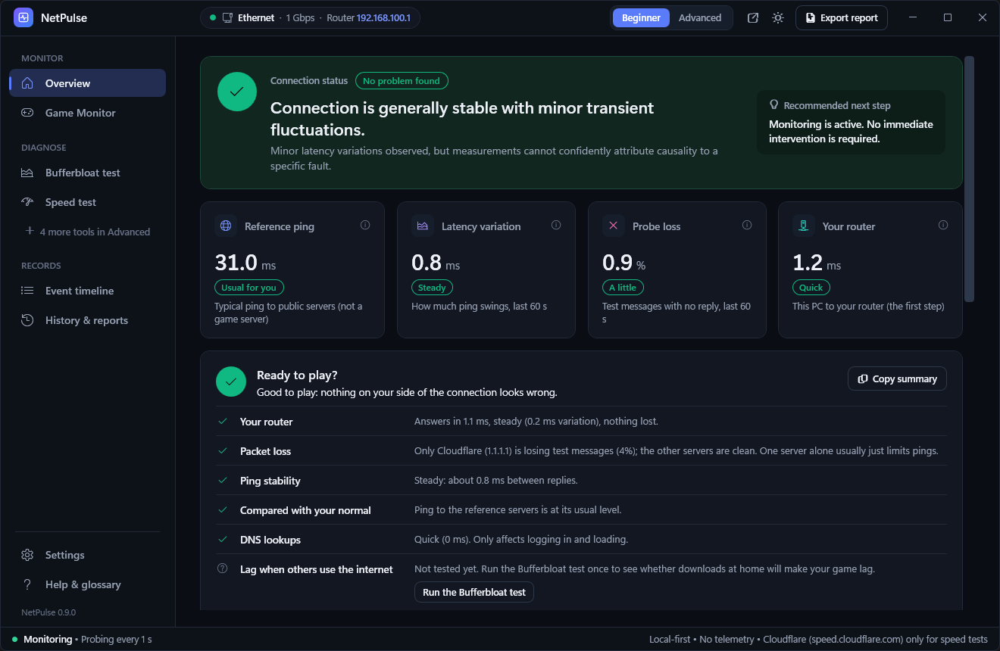

# ⚡ NetPulse - Real-Time Internet Connection & Path Diagnostics

> A native Windows desktop application designed to diagnose and visualize Internet connection health, identify the exact origin of network degradation, and analyze routing paths in real time.

[-blue.svg)]()
[-512BD4.svg)]()
[]()
[]()
[-success.svg)]()



**[Download the latest portable build from the Releases page](../../releases/latest)**: extract and run, no install or admin rights needed.

---

## 📖 Table of Contents
- [Executive Overview](#-executive-overview)
- [The Core Diagnostic Problem](#-the-core-diagnostic-problem)
- [Key Features](#-key-features)
- [Beginner and Advanced](#-beginner-and-advanced)
- [Multi-Layer Measurement Architecture](#-multi-layer-measurement-architecture)
- [Hop-by-Hop Path Discovery & Continuous MTR](#-hop-by-hop-path-discovery--continuous-mtr)
- [Bufferbloat & Loaded Latency Engine](#-bufferbloat--loaded-latency-engine)
- [Download & Installation](#-download--installation)
- [Building from Source](#-building-from-source)
- [Documentation Links](#-documentation-links)

---

## 🎯 Executive Overview

Most network utilities merely send ICMP echo packets to a single remote address (like `8.8.8.8`) and show a simplistic ping number. If the ping is high, standard users have no idea where the problem actually lies:
* Is it their computer's Wi-Fi connection?
* Is it their home router?
* Is their ISP experiencing congestion?
* Is their DNS resolver slow or failing?
* Is a specific remote server overloaded?
* Is someone in the household downloading a large file (Bufferbloat)?

**NetPulse** was engineered from the ground up to solve this attribution problem. It treats the Internet connection as an end-to-end chain:

```
[ PC / Wi-Fi Adapter ] ──► [ Home Router / Gateway ] ──► [ ISP Access ] ──► [ Transit Backbone ] ──► [ DNS / Remote Server ]
```

By probing every layer independently using multiple protocols (ICMP, TCP, HTTPS, and DNS), NetPulse continuously correlates evidence to provide plain-English, evidence-based diagnoses for everyday users while equipping network engineers with granular MTR tables, TCP/TLS handshake breakdowns, and route change tracking.

---

## 🔍 The Core Diagnostic Problem

NetPulse clearly distinguishes between:

1. **Problems on the local network (PC ↔ Router / Wi-Fi):** High gateway RTT, local packet loss, low Wi-Fi signal.
2. **Problems on the ISP or Internet path:** Local gateway responds in <1ms with 0% loss, but multiple diverse Internet targets degrade.
3. **Problems specific to DNS:** IP packets travel quickly, but domain name lookups time out or take >150ms.
4. **Problems specific to a single remote server:** Diverse global endpoints respond normally, while only one specific destination fails.
5. **Problems caused by congestion / Bufferbloat:** Unloaded latency is low, but jumps dramatically (+50ms to +200ms) under download/upload load.
6. **Problems caused by routing changes:** Upstream hop divergence coincident with a persistent latency increase.
7. **Inconclusive scenarios:** Transparently acknowledged when measurements do not provide sufficient evidence to pinpoint causality.

---

## ✨ Key Features

- **Multi-Protocol Probing:** Combines ICMP, TCP handshake, HTTPS (DNS + TCP + TLS + TTFB), and direct RFC 1035 UDP DNS queries.
- **Continuous Hop-by-Hop MTR:** Discovers every hop along the route with packet loss %, Min/Max/Avg RTT, and Autonomous System (ASN) lookup.
- **Persistent Latency Jump Detection:** Intelligently distinguishes between intermediate routers rate-limiting ICMP responses vs true downstream transit degradation.
- **RFC 3550 Interarrival Jitter:** Implements standard statistical jitter:
  $$\text{Jitter}_{new} = \text{Jitter}_{old} + \frac{|\Delta\text{RTT}| - \text{Jitter}_{old}}{16}$$
- **Full Statistical Suite:** Real-time Minimum, Maximum, Mean, Median, and 95th Percentile (P95) latency over rolling sliding windows.
- **Bufferbloat / Loaded Latency Test:** Automated 3-phase test (Baseline $\rightarrow$ Download Load $\rightarrow$ Upload Load) with letter grades (A+ to F) and router SQM recommendations.
- **On-Demand Bandwidth Benchmark:** Multi-stream throughput test with traffic warning prompt and live Mbps gauge.
- **Active Adapter & Wi-Fi Telemetry:** Reports interface name, link speed, IPv4/IPv6, gateway, DNS, and native Windows Wi-Fi metrics (SSID, signal strength %, channel, 802.11 protocol).
- **Chronological Event Timeline:** Records latency spikes, packet loss bursts, gateway degradations, route shifts, network switches and Wi-Fi access-point roaming.
- **Desktop alerts:** a Windows notification when the connection drops and comes back, the router stops answering, packets are being lost or Windows switches network; rate-limited, background-only by default.
- **Game Monitor (7 games, all Reference-only):** detects the game, lists the connections its process opens, records the session, and marks lag with a system-wide shortcut (default `Ctrl+Shift+F9`) that works while the game has focus. Optional automatic recording starts when the game starts and saves when it closes. See [docs/GAME_MONITOR.md](docs/GAME_MONITOR.md).
- **History & reports:** every recording with an interactive graph (hover for exact values), per-target statistics, what was measured around each lag marker, and Markdown/CSV export.
- **When is my connection worst?** History pools every recording by hour of the day, comparing each server with its own usual ping.
- **Live ping graph** of the last minutes on the Overview, and **Copy summary**: a short text snapshot (no IP addresses or network names) to paste into a chat or support ticket.
- **Keyboard shortcuts:** `Ctrl+1`...`Ctrl+0` for the pages, `Ctrl+Shift+C` copy summary, `Ctrl+E` export, `F1` help.
- **Local-only privacy:** no accounts, no telemetry. Settings, recordings and an error log stay in `%LOCALAPPDATA%\NetPulse`; optional automatic clean-up of old recordings.
- **Native Windows Desktop Integration:** tray icon with live status and quick actions (Mark lag, start/stop the Game Monitor), minimize/close to tray, start with Windows.

---

## 💡 Beginner and Advanced

NetPulse serves both players who just want an answer and people who want every number. Switch at any time with **Beginner / Advanced** at the top of the window; a welcome card asks on first start.

### Beginner: the essentials, in plain words
- **Connection status** with a plain-English verdict and a recommended next step.
- **Headline numbers with a one-word rating**, judged against *your own* normal rather than fixed limits: ping "Usual for you" / "Higher than usual", stability "Steady" / "Some wobble" / "Unsteady", loss "None" / "A little" / "Losing packets", router "Quick" / "Slower than ideal".
- **Ready to play?** checklist: router, packet loss, ping stability, compared with your normal, DNS, Wi-Fi signal and lag under load, each with a short reason. **Copy summary** puts a text version on the clipboard.
- A shorter sidebar: Overview, Game Monitor (one "What the game is connected to" summary), Bufferbloat and Speed tests, Event timeline, History & reports.
- `ℹ` buttons on every metric explain the term without jargon.

### Advanced: everything, plus the evidence
- **Per-server statistics** on the Overview: now vs usual latency, 95th percentile, variation, loss and state.
- **Targets & probes** with an HTTPS timing breakdown (DNS, TCP connect, TLS handshake, first byte).
- **Route trace** (continuous hop-by-hop MTR with ASN lookup and route comparison), **Adapter & Wi-Fi** details, and a live **Probe log** of every measurement, filterable and pausable.
- The full Game Monitor connection tables, with the option to measure an endpoint the game opened.
- The measured evidence behind each verdict, and how each glossary term is measured.

---

## 🗺️ Hop-by-Hop Path Discovery & Continuous MTR

Under the **Route & MTR** view, NetPulse conducts active path analysis:

```
Hop 1:  192.168.100.1   (LAN Gateway)            0.8 ms    0% Loss   AS: Local Network
Hop 2:  41.108.96.1     (ISP Access Gateway)     2.4 ms    0% Loss   AS: Telecom Access
Hop 3:  10.104.15.13    (ISP Backbone)           2.9 ms    0% Loss   AS: Private Core
Hop 4:  *               (ICMP Filtered Router)     --    100% Loss   [No Transit Impact]
Hop 5:  1.1.1.1         (Cloudflare Edge)        4.1 ms    0% Loss   AS13335 (Cloudflare)
```

### Anomaly Rules:
1. **Control-Plane vs Forwarding-Plane:** If Hop 4 does not respond to ICMP, but Hop 5 responds in 4.1ms with 0% loss, NetPulse flags that Hop 4 is rate-limiting ICMP responses and that transit traffic is unaffected.
2. **Persistent Latency Jumps:** If a sudden +60ms latency jump occurs at Hop 3 and persists across all subsequent hops to the destination, NetPulse highlights that hop with `⚠️ Sustained Jump`.
3. **Route Divergence Analysis:** Compare two destinations (e.g., Cloudflare vs Google) to pinpoint the exact common hops and the hop where the paths diverge.

---

## ⚖️ Bufferbloat & Loaded Latency Engine

Bufferbloat is high latency caused by excessive buffering in consumer home routers during large downloads or uploads:

| Grade | Latency Increase | Assessment |
|:---:|:---:|:---|
| **A+** | $\le 5\text{ ms}$ | Pristine. Zero perceptible lag while downloading. |
| **A** | $5 - 15\text{ ms}$ | Excellent. Minimal buffering. |
| **B** | $15 - 30\text{ ms}$ | Good. Minor latency buildup. |
| **C** | $30 - 60\text{ ms}$ | Noticeable. Gaming or voice calls may stutter during downloads. |
| **D** | $60 - 150\text{ ms}$ | High bloat. Smart Queue Management (SQM) recommended. |
| **F** | $> 150\text{ ms}$ | Severe bufferbloat. Packets are delayed hundreds of milliseconds. |

---

## 📦 Download & Installation

The application is completely self-contained. **No .NET SDK or runtime installation is required.**

### 1. Portable Version (Zero Install)
1. Download `NetPulse-<version>-Portable-win-x64.zip` from the [latest release](../../releases/latest). Each release lists its SHA-256 checksum.
2. Extract the archive anywhere on your machine.
3. Launch `NetPulse.exe`.

Building it yourself: run `build.ps1`, then use `dist/NetPulse-<version>-Portable-win-x64.zip` (the verified portable build is also unpacked in `dist/portable/`; every verified build is kept under `dist/releases/<version>/` with its release notes and `build-info.json`).

### 2. Standalone Windows Installer (`NetPulse-Setup.exe`)
1. Build it with `build.ps1` (the installer is not attached to the GitHub releases), then run `dist/releases/<version>/installer/NetPulse-Setup.exe`.
2. Click **Install**.
3. NetPulse installs to `%LocalAppData%\Programs\NetPulse` without requiring administrator privileges, creates Desktop and Start Menu shortcuts, and registers with Windows Add/Remove Programs.
4. To uninstall, run `NetPulse-Setup.exe --uninstall` or use Windows **Installed Apps**.

### 3. PowerShell One-Click Setup
Right-click `installer/Setup-NetPulse.ps1` and select **Run with PowerShell**, or execute:
```powershell
powershell.exe -ExecutionPolicy Bypass -File .\installer\Setup-NetPulse.ps1 -Launch
```

---

## 🛠️ Building from Source

NetPulse targets modern **.NET 10.0-windows** with high-performance native WPF rendering.

### Prerequisites
- Windows 10 (Build 19041+) or Windows 11 (x64)
- [.NET 10.0 SDK](https://dotnet.microsoft.com/)

### Build & Run Tests
```powershell
# Restore and build the solution
dotnet build NetPulse.slnx

# Run the automated unit and integration tests
dotnet test tests/NetPulse.Tests/NetPulse.Tests.csproj

# Run the master automated build & release packager
.\build.ps1
```

---

## 📚 Documentation Links

- [Game Monitor: what it does and what is verified](docs/GAME_MONITOR.md)
- [Architecture & Design Document](docs/ARCHITECTURE.md)
- [Measurement Methodology & Statistical Definitions](docs/METHODOLOGY.md)
- [Release notes](RELEASE_NOTES.md)

---

*NetPulse Diagnostics • Built for precision, clarity, and reliability.*


## Game Monitor

See [docs/GAME_MONITOR.md](docs/GAME_MONITOR.md) for exactly what the Game Monitor does, its limitations, and what has and has not been verified. User data (settings, recordings) is stored in `%LOCALAPPDATA%\NetPulse`, never beside the executable.
