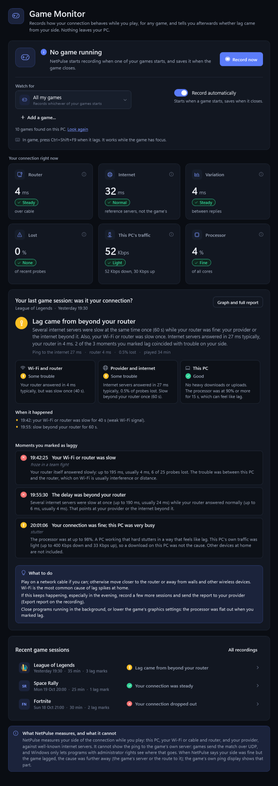

# Lagwise release notes

Lagwise was called **NetPulse** up to and including 0.16; the notes for those versions keep the old name.

Newest first. Versions 0.1 to 0.16 were published as repositories named NetPulse-ver0.1, -ver0.3, ... -ver0.16; 0.10 follows 0.9, and 0.17 was folded into 1.0 without a release of its own; builds made before 0.3.0 were numbered 1.0.0-1.2.0. `build.ps1` copies the section matching the version in `Directory.Build.props` into every verified release.

## 1.0.0

**NetPulse is now Lagwise.** Same app, new name. On its first start Lagwise copies your NetPulse settings, recordings, diary and test results from `%LOCALAPPDATA%\NetPulse` to `%LOCALAPPDATA%\Lagwise` (the old folder is left as it was; delete it when you like), and "Start with Windows" carries over. The installer removes an installed NetPulse (its shortcuts, Apps entry and program files) so only Lagwise is left.

Lagwise 1.0. The Game Monitor works for any game on any PC and answers the question players actually have: **was it my connection?** Everything it does is verified automatically, without a real match. This release also makes Lagwise itself safer to run (the work planned for 0.17).

**The Game Monitor, rebuilt for any game**
- **Finds your games by itself.** Windows 10 and 11 keep a list of the games they have seen run on each PC (the one Game Bar and Game Mode use). Lagwise reads it, read-only, and adds its seven built-in games and any program you add with **Add a game...**. A game you do not want watched can be taken off the list.
- **Watches all of them by default**, and **records automatically when one starts** (now on by default), saving when it has been closed for 20 seconds. Settings from an earlier version are switched to all games with automatic recording once; the switch on the Game Monitor turns it off. A recording you stop while the game runs is not restarted until the game closes and starts again. **Record now** also works before the game is running: the recording takes the first game that starts.
- **A verdict for every session: was it my connection?** Afterwards Lagwise says whether lag came from your side and which part: your Wi-Fi or router, beyond your router (your provider or the internet), or this PC (its own downloads, or a processor working flat out). Each part gets its own rating, every stretch of trouble is listed with its time, and each moment you marked as laggy gets its own answer, with the numbers. When your side was fine, it says so: the lag was further away, at the game's server or on the route to it.
- **Live while you play:** six tiles (router, internet, variation, loss, this PC's traffic, processor) and **This session so far**, worked out every few seconds.
- **Your last game session and the recent ones** on the Game Monitor, each with its verdict.
- **Recordings keep this PC's processor load and Wi-Fi signal** every second, beside its traffic.
- **Automatic recordings stay tidy:** the newest 50 are kept (Settings > Recordings: 20, 50, 200 or all); older ones go when a new one is saved, except those in which you marked lag.
- **Removed:** the table of the game's connections, measuring one of them, the per-game "Reference-only" labels and the findings with confidence levels. They measured the game's web services, not the match, which Windows does not show. Shared store clients (Steam, Epic Games Launcher, EA app, Battle.net) no longer count as any game's launcher.
- Apex Legends is now found by `r5apex_dx12.exe` too, as Windows' game list showed on a real PC.

**History and reports**
- Every recording opens with **Was it your connection?**, worked out again by this version from its measurements, so older recordings get a verdict too. The list of recordings shows each one's verdict.
- The exported report starts with the verdict: the parts of the connection, when it happened, every lag mark, and what to do.

**At home in Windows**
- **One Lagwise at a time.** Starting it again (or Windows starting it at sign-in while it already runs) brings the running Lagwise forward instead of opening a second copy that measured twice and wrote the same files. The request travels over a channel only you can open, only from this PC (Windows refuses it to other computers), and only a fixed set of requests is accepted.
- **Taskbar jump list:** right-click Lagwise on the taskbar or in Start for Mark lag, Start or stop a game recording, the mini overlay, the speed and bufferbloat tests and History, also while Lagwise sits in the tray.
- **The taskbar button and the tray icon show the connection at a glance:** an amber dot when something is worth a look, red for a problem; a record dot on the taskbar button while recording; the button fills like a progress bar during a speed or bufferbloat test. Hovering the button offers Mark lag and Record or Stop under the preview.
- **Sleep and wake are not outages any more.** Waking up used to count the few seconds the adapter needs to reconnect as a drop, with a "Connection lost" notification. Now the time asleep shows as a gap, the adapter gets up to 45 seconds to come back, and a recording in progress is saved to disk as Windows goes to sleep. Signing out or shutting down saves it too.
- **Sharp on every screen:** Lagwise follows each monitor's scaling (per-monitor DPI), so it is no longer blurry on a second screen with other scaling.
- **Snap Layouts:** hovering the maximise button offers Windows 11's layouts, as on Windows' own windows.
- **The mini overlay never takes the keyboard from your game** when clicked or dragged, stays out of Alt+Tab, and can let clicks pass through to the game (Settings > Appearance).
- **Start with Windows tells the truth:** when Lagwise is switched off in Task Manager > Startup apps, Settings says so, and switching it on again in Lagwise works. A moved portable Lagwise repairs its startup entry.
- **The installer closes a running Lagwise** (which saves what it is recording) before replacing or removing it, and uninstalling removes the startup entry, so Windows no longer tries to start a deleted program. Settings > Apps offers only Uninstall.

**Your connection, measured where it actually goes**
- **The adapter Windows really uses.** With several adapters connected (cable and Wi-Fi, a virtual switch), Lagwise used the first one with a router; it now asks Windows' routing table which adapter carries internet traffic.
- **VPNs are recognised.** When internet traffic goes through a VPN or tunnel, the Adapter page, "Ready to play?", the copy summary and reports name it, and a recording's verdict says that slowness beyond your router may be the VPN's, with advice to try a closer VPN server or play once without it. Your own router is still measured directly.
- **Wi-Fi details in every Windows language.** Signal, network name, access point, standard, channel, link rate and protection now come from Windows' WLAN API rather than the English text of netsh, so Wi-Fi verdicts and the Security check's Wi-Fi line work on French, German, Spanish or any other Windows. Since Windows 11 24H2, Windows shares these details only with apps allowed to use location; the Adapter page explains this and opens the right Settings page. Lagwise never asks where you are.
- **Fewer false alarms about your router.** A router answering slowly, unevenly or not at all is now counted only when the internet servers behind it show the same trouble (and "slow" only when no internet server answers faster than the router). Routers answer pings to themselves last, and a repeater's or mesh unit's Wi-Fi link on the way can make the replies swing; when the traffic through the router stays steady, neither reaches your games. A healthy wired PC behind a mesh repeater whose router swung by 4 ms was told "worth keeping an eye on"; now it is good to play. When the router really is the problem, Lagwise now says that a repeater or mesh unit and its Wi-Fi link count as part of your home network, and suggests moving it closer or wiring it. The Game Monitor's router tile uses the same judgement instead of a single reading.

**Clearer at the usual window size**
- Every page fits in the sidebar without scrolling, also in Advanced (Settings and Help share the last row).
- The History list shows each verdict in a few words ("Steady", "Wi-Fi or router", "Beyond your router"; the full sentence on hover), marks interrupted recordings under their name and fits without cutting columns off. Probe counts are an Advanced column.
- Shorter labels where they were cut off; the router tile shows a cable or Wi-Fi symbol to match the connection.

**The .NET runtime inside Lagwise is current again**
- Lagwise carries its own .NET runtime, which Windows Update does not patch. Up to 0.16.0 it carried .NET 10.0.3, which nine later security updates fixed. This release carries .NET 10.0.13 (October 2026).
- The build now asks Microsoft's release feed for the latest .NET 10 patch, bundles it, and refuses to finish if the exe reports another runtime. The runtime is recorded in build-info.json. Use the newest Lagwise: an old copy keeps its old runtime.

**Hostile answers from the network**
- **Text from outside** (reverse-DNS names of route hops, certificate names, status pages, redirect addresses, server messages) has control and invisible characters removed and is shortened before it is shown or put in a report. Direction overrides (U+202E) can make "gpj.exe" read as "exe.jpg". A reverse-DNS name that is not a valid host name is dropped.
- **CSV exports** quote every text field, and a field starting with = + - @ gets an apostrophe, so Excel or another spreadsheet never runs it as a formula.
- **Site icons** are never fetched from an address on this PC or the home network, whatever a page or a redirect names, so a website cannot use Lagwise to send requests to your router.
- **DNS probes** count an answer only from the server asked and with the question's number, so another device cannot fake one.
- **Size and time limits:** status and DNS-over-HTTPS answers are limited to 1 MB, and reading a page for its icon has a time limit, so a page built to be slow cannot stall it.
- **A status page of another shape** (for example "status" as text) is now read as "no answer" instead of raising an error.

**Checked, nothing to fix**
- A running Lagwise has no open TCP port and no lasting UDP socket, and creates no firewall rule.
- Everything it keeps is in a folder only you (and administrators) can read. No administrator rights; per-user installer; Windows tools started by full path.

**Verified automatically, without a real game**
- A stand-in game (a small program with a UDP socket and an internet connection, like an online game) is added the way a user adds one. The GUI check of the published exe starts it, then checks that:
  - Lagwise records by itself, and lag is marked by button and by the system-wide shortcut;
  - the live verdict appears;
  - closing the game saves the recording, which shows its verdict on the Game Monitor and in History;
  - a second start hands over instead of running twice, the jump list's Mark lag and History reach the running Lagwise, and being asked to exit (as the installer does) saves and closes it.
- The published exe's self-test does the same with real Windows process and socket APIs, and reads Windows' game list.
- New automated tests cover the game library, exact-path detection, watching all games and the verdict in every situation, and the Windows side: the request channel, sleep and wake, the startup entry and Task Manager's switch for it, reading Wi-Fi from the WLAN API, choosing the adapter and recognising VPNs.

**Also**
- `Lagwise.exe --screenshot "GameMonitor=gm.png"` renders pages to image files without a screen, for documentation (`--screenshot-window` renders the whole window).
- Stat tiles colour their rating by level on their own; the Help page and glossary describe the verdict and how games are found.

## 0.16.0

A security release: a new Security check, and NetPulse itself hardened.

**New: Security check** (both modes)
- Is this PC and its connection safe? Read from Windows as soon as the page opens, without administrator rights and without sending anything:
  - **Windows Firewall:** on or off for each kind of network, and for the one you are on.
  - **Network type:** Public (other devices cannot find this PC) or Private (fine at home, a problem on an open Wi-Fi).
  - **Wi-Fi protection:** open, WEP, WPA/TKIP (old, breakable), WPA2 or WPA3 (English and some other Windows languages).
  - **Programs open to the network:** the programs waiting for connections from other devices; remote access (Remote Desktop, VNC, Telnet, FTP, SSH, TeamViewer) is flagged, and is a problem with the firewall off.
- With **Check**, a few harmless connections add:
  - **Honest name lookups:** does your DNS give an address for a name that does not exist (sending typos to advertising)?
  - **Real servers for well-known sites:** do Google, Cloudflare and Wikipedia prove who they are at the addresses your DNS gives?
  - **Secure connections:** does a program or network open your HTTPS connections? A certificate authority installed on this PC (antivirus scanning, a company proxy, or something unwanted) is named.
  - **UPnP on your router:** can programs open ports on it without asking?
- Each line says what it means and what to do. Information lines never make the verdict worse. A worrying result is noted in the event timeline.

**Hardening**
- **Windows tools are started by their full path.** netsh, Explorer and cmd used to be started by name, and Windows looks in the program's own folder first: a program called netsh.exe placed next to a portable NetPulse (in Downloads, say) would have run instead. The uninstaller had the same issue with cmd.exe, and now also refuses a folder name with characters that could change its command line.
- **Only web addresses are opened in the browser** (http and https); folders are opened in Explorer by full path.
- **Icons from the internet** are refused above 256 KB or 512 pixels before the image decoder sees them.
- **A hung netsh can no longer block the network readings:** it is stopped after 4 seconds.
- **Exported reports leave out home-network and IPv6 addresses** by default (they read `[hidden]`), so a report can be posted on a forum safely. Settings > Privacy and data includes them when your provider's support asks. Public servers and route hops stay.
- **[SECURITY.md](SECURITY.md):** what NetPulse never does, everything it sends and when, what it keeps, how it is built to be safe, how to check a download's SHA-256, and how to report a vulnerability privately.

**Also**
- Status marks can be drawn larger (the Security check's verdict) and have an "i" for information.
- Help explains the Security check.

## 0.15.0

**New: Site check** (both modes, `Ctrl+K`)
- Is a site down, or is something between you and it blocking it? Fifteen popular sites are listed (YouTube, X, Reddit, Twitch, Discord, Google, Wikipedia, Instagram, Facebook, TikTok, Netflix, Spotify, Steam, Epic Games, Riot Games), and you can add your own or take any off the list.
- A check retraces what a browser does and says where it stops: this PC's hosts file, your DNS (your provider's or router's), public DNS over HTTPS (Cloudflare and Google, reached by address so a broken DNS cannot stop them), the connection, the secure handshake and the answer. Open a site for the step-by-step view.
- Verdicts: Up, Slow, Blocked on this PC, Blocked by your DNS, Blocked on the way (the connection is cut as soon as it names the site: filtering by name, SNI), Intercepted (a certificate that is not the site's: a block page, antivirus or parental controls, a company network or a Wi-Fi sign-in page), Legal block (HTTP 451), Problem at the site, Unreachable, No internet. Each comes with what you can do.
- **Down for everyone?** Reddit, Twitch, Discord, Wikipedia and Epic Games publish a public status page, read with each check. X's status page only answers with an API key, so it is not used. From one PC a site that is down and a site whose address is blocked look the same; the verdict says so instead of guessing.
- No account, cookie or key is used, and bot checks are never solved: a bot check already proves the site answers.
- Nothing is contacted unless you press Check, or switch on the regular check (every 15 minutes, off by default), which notes changes in the event timeline.
- Each site shows its own icon, fetched from the site as a browser tab shows it, once a month.

**New: Connection diary** (both modes, `Ctrl+D`)
- How your connection did hour by hour, every day NetPulse runs, recording or not: a heatmap of the last 7, 14 or 30 days, coloured by overall quality, ping above usual, variation, probe loss or drops. Hover any hour for its numbers; fainter hours were only partly measured.
- Every drop, with its length and where the break was: beyond your router (modem or provider) or with the router silent too (cable, Wi-Fi or the router).
- A summary: time measured, drops, the worst hour, and whether evenings run above the rest of the day.
- A **Last 24 hours** strip on the Overview.
- The exported report gains the diary (one line per day, every drop) and the latest site check; Copy summary gains a line about the last 7 days.
- Kept on this PC for 31 days (`diary.json`).

**Fixed: "Connection lost" now covers outages beyond your router.** It used to need every probe to fail, the router included. When the modem or the provider is down the router keeps answering, so the most common outage was never reported as one: no desktop alert, no "connection lost" period in recordings. Now nothing on the internet answering for 3 cycles is a drop (once it has answered since NetPulse started, so a network that blocks pings is not "down"), and the timeline and the alert say whether your router still answered.

**New: Ready to play? when your game starts.** When the selected game starts, a desktop notification gives the checklist's verdict ("League of Legends started: good to play", or the items to watch), so a problem on your side is known before the match. Not for a game already running when NetPulse starts. Settings > Desktop alerts.

**Visual refresh**
- **New NetPulse logo and app icon** (title bar, overlay, taskbar, tray and installer), drawn as vectors so it is sharp at every size.
- **Ratings read without colour:** the Overview tiles' ratings carry a symbol and a tint (a tick, "!" or a cross), and new status marks show the state in Site check, the overlay and the diary.
- The Probe loss tile no longer uses a cross as its icon (it looked like an error even at 0%).
- **Games show their own icon** in the Game Monitor and on the Overview once NetPulse has seen them (or their launcher) running, taken from the program as Explorer shows it; their initials until then.
- **Mini overlay:** the logo, a status mark for "Ready to play?", and a graph of the last minute of ping (Settings > Appearance).

**Also**
- The footer says outside services are only contacted when you run a test or a site check; Help lists `Ctrl+D` and `Ctrl+K` and explains drops, the diary, DNS blocks and filtering by name.
- A live test of HTTPS timing retries a passing network blip twice before failing the build.

## 0.14.0

**Evidence over time:** NetPulse now keeps what it measures, so a slow evening or a laggy download can be shown rather than remembered.

**New: your results over time** (Speed test and Bufferbloat pages)
- Every finished Speed and Bufferbloat test is kept on this PC (`test-history.json`, the latest 500), with a bar chart of the latest 12 and the 5 newest as text.
- A plain conclusion under each chart, for example "Evening tests are 46% slower than daytime ones (220 against 410 Mbps down, cable tests only). Slower evenings usually mean your provider's network is busy at peak time." Evenings (18:00 to midnight) and daytime are only compared on one kind of connection, so a Wi-Fi test among cable tests cannot fake a slow evening. Wi-Fi and cable are compared when both were tested.
- The Speed test shows your last result after a restart instead of zero. The Bufferbloat result remembered by earlier versions starts the history.
- **Clear** forgets the stored results of that page, after asking.
- Only numbers and the kind of connection (Wired or Wi-Fi) are stored: no addresses, adapter or network names.

**New: lag under real load, without running a test**
- When this PC itself moves a lot of data (a game update, a cloud backup) and the heavy-traffic stretch ends, the timeline gets a "Heavy traffic ended" entry saying how much your ping rose meanwhile: "Ping to the reference servers rose by 38 ms meanwhile (14 ms before, 52 ms during): the load made your connection queue (bufferbloat)...". Each reference server is compared with its own ping in the minute before, so distance never looks like a rise.
- The observation is kept with the Bufferbloat results (outlined bars, "Seen in real use") but never graded: the line may not have been full, so a steady ping proves little. The page says so.
- "Ready to play?" uses it honestly: without a Bufferbloat test, a clear rise (over 30 ms) seen in the last two weeks is reported as a likely problem; a steady ping stays "not tested". With a test, its grade stands, and a newer, clearly worse observation is mentioned.

**New: lag marks and this PC's own traffic** (History, recordings from 0.13 on)
- Each moment you marked as laggy says whether this PC was busy at the time ("This PC was busy: up to 48 Mbps down... That traffic competes with the game") or its own traffic was light, so a download on this PC was not the cause.
- A line above the list sums it up ("2 of the 3 moments you marked came while this PC was busy..."). The exported recording report includes both. "Busy" uses the heavy-traffic limit from Settings.

**Improved**
- **Heavy-traffic stretches tolerate short dips.** A dip below the limit shorter than 5 seconds no longer ends a stretch, so a bursty download (a launcher pausing to write to disk) is one stretch, not several or none.
- **The exported report (Ctrl+E) is rewritten in plain words:** local times with the time zone, event names as on screen (not internal codes), newest events first, a "Tests over time" section with the conclusions and the latest 30 results, and no Wi-Fi network name or access point address (a provider does not need them). It says it contains local network addresses and that nothing in it is game-server ping.
- **Speed test:** no more pop-up asking to confirm; the page already says what the test does. While a recording runs, both test pages warn that the test will show up in it. Data transferred reads "212 MB" instead of a 9-digit byte count.
- Help: the Bufferbloat glossary entry explains the real-use observation.

## 0.13.0

**Network activity, refined**
- **Ping on the traffic graph.** Your reference ping (one value per second, from the plain-ping reference servers) is drawn as a pink line on its own axis on the right. If it climbs whenever a download runs, that is bufferbloat, happening live. Toggle it with **Ping**.
- **Mirror mode.** Download above the middle line, upload below, on one shared scale, so the two never hide each other. Toggle it with **Mirror**.
- **Pause.** Freezes the graph and numbers for a closer look; NetPulse keeps measuring in the background.
- **Programs online now.**
  - Lists the programs on this PC with internet connections open, checked every few seconds, with how many connections and addresses each one has.
  - Programs that often download or upload a lot are marked: game launchers and stores, cloud sync, Windows Update and services, torrent clients, browsers, streaming. Game clients are recognised from the game profiles, for example "League of Legends (client)".
  - Windows reports which program owns each connection but not how much data each one moves (that needs administrator rights), so this shows who is talking to the internet, not exactly who is using the bandwidth. The page says so.
- **Heavy-traffic timeline entries name the likely programs.** For example: "...Programs online at the time that often download or upload a lot: Steam (12 connections), OneDrive (3)."
- **The heavy-traffic limit is a setting.** Settings > Events offers Off, 5, 15 (default), 30 or 100 Mbps, to suit slow and fast connections.

**Recordings keep the traffic**
- Every recording now stores this PC's download and upload for each second. History has a new **Network activity** graph view: traffic, the recorded ping on the right axis, and amber dashes where you marked lag. Lag that lines up with a traffic peak was probably caused by it. Recordings made before 0.13 say they have no traffic data.

**Mini overlay**
- Shows this PC's live download and upload under the ping. Turn it off in Settings > Appearance.

**Also**
- The ping axis uses whole steps (5 / 10 / 20 ms ...).
- History's graph picker has an accessible name ("Graph view") for screen readers.

## 0.12.0

**New: Network activity page** (both modes, `Ctrl+3`)
- Live download and upload of this PC's network adapter, read once a second from the same counters Task Manager uses:
  - a large chart with gradient-filled download and upload areas, an auto-scaled speed axis and a hover read-out (time, speeds, packets per second);
  - a 1, 5 or 15-minute window;
  - current, peak and average speed for each direction, and data received and sent since NetPulse started;
  - how much of the adapter's link speed is in use;
  - packets per second, and errors and dropped packets counted by the driver.

  You can pick the adapter when the PC has more than one; the one Windows uses for the internet is chosen by default.
- **Heavy traffic is noted in the timeline.** When this PC moves more than 15 Mbps for 10 seconds or longer, the timeline gets a "Heavy traffic on this PC" entry: a Warning while the Game Monitor is recording, otherwise Info. A lag spike you marked can then be matched with a download, update or backup. NetPulse's own Speed and Bufferbloat tests are not counted, and other devices at home are not seen.
- `Ctrl+H` opens History, since the sidebar now has more pages than number keys.

**Fixed**
- **Settings: the Save and Discard buttons looked broken.** They were always visible and greyed out, including while changing Appearance or Detail level, which apply instantly and never need saving. The bar now appears only when something is waiting to be saved, and for a few seconds after saving to confirm. The page header says which sections apply instantly.

## 0.11.0

Another polish and bug-fix release.

**Fixed**
- **The Bufferbloat test could grade a line that was never full.** Each load phase lasted only 5 seconds with 3 download and 2 upload streams, and 200 KB counted as "a load", so a fast connection could get an A+ ("virtually no latency increase under heavy load") without ever being busy. The test also took about 12 s while the page promised 30.
  - Phases now last 10 seconds, with 6 download and 4 upload streams.
  - Pings from the first 2.5 seconds, while the transfer speeds up, are shown but not graded.
  - A phase needs at least 2 MB to count.
  - The speed reached is recorded and shown with the result ("+3.1 ms over rest, at 412 Mbps") and in the explanation, so you can see what the grade was measured under. The grade texts are in plain words.
- **The Speed test under-reported fast connections.** It averaged from the very first byte, including the slow start of every transfer. It now measures after a 2-second warm-up, with 6 download and 4 upload streams and slightly longer phases (about 15 seconds in all).
- **Game Monitor race:** two overlapping polls could apply an older process reading after a newer one, resetting the automatic stop countdown and logging a false "game restarted". Polls now run strictly one at a time. This also fixes two automated tests that failed now and then (18 consecutive clean runs after the fix).
- **Exports could fail with "Something went wrong".** Saving a report, CSV or JSON file to a locked file or a protected folder was not handled. It now says why in plain words ("The file is open in another program...") and suggests what to do.
- **History exports confirmed off-screen.** "Report saved" was written at the top of the page, out of sight of the export buttons further down.

**New: notifications inside the window**
- Results of exports and deletions show as a short notification at the top of the content, with **Show in folder** to select the file in Explorer. This replaces the old pop-up message boxes. Notifications close by themselves after a few seconds; errors stay longer.

**Polish**
- **Keyboard focus is visible.** Tabbing through the window now shows an accent ring around the focused button, page, switch or dropdown. Before, only text boxes showed focus. The ring never appears after a mouse click.
- **Example text in empty boxes:** "Add a server" shows what to type ("Address, e.g. 9.9.9.9 or example.com"), and History's comparison picker says "Choose a recording...".
- **Settings:** the "History used for your 'normal'" description explains the long-term memory added in 0.10. The latency-spike setting notes that HTTPS and DNS timings are not counted. "Collapse repeated events" choices no longer run into the dropdown arrow.

## 0.10.0

A polish release: no big new features. Every page was checked in both modes and both themes, and what looked wrong, read badly or misled was fixed.

**Fixed**
- **Event timeline error** (since 0.7): opening the Event timeline once an event existed showed "Something went wrong" and the list stayed empty. A colour lookup was written in a form WPF cannot use there. The automated check now opens every page in both modes and fails if any page logs an error.
- **"Usual for you" during a slow evening.** "Usual" only covered the last 15 minutes, so after starting NetPulse on a bad evening the bad ping itself became "usual". NetPulse now remembers each server's normal ping across restarts (`baselines.json`): a sample every 10 minutes of monitoring, the median of the last ~8 hours of samples, nothing older than 14 days. A slow evening now shows as "Higher than usual". A lasting change, such as a new provider, becomes the new normal within a few hours.
- **The tiles and the checklist disagreed.** For example, the Probe loss tile said "A little" while "Ready to play?" marked packet loss red. Both used the same rule but were judged seconds apart, so values near a limit flipped. The tile ratings now come from the same evaluation as the checklist.
- **No more "latency spike" events from HTTPS handshakes and DNS lookups.** Those timings include server and cache time that swings by hundreds of milliseconds on its own, and they filled the timeline. Spike events are now reported for plain ping and TCP round trips only.
- **Cached DNS lookups** showed as "0 ms". They now read "under 1 ms, answered from Windows' cache" in the checklist and "DNS cached" in HTTPS timings.

**Clearer**
- The connection status texts are rewritten in plain words. For example "Connection is generally stable with minor transient fluctuations ... cannot confidently attribute causality to a specific fault" is now "Your connection is mostly steady, with small ups and downs". "Save and share this report with your ISP" now only suggests it if the problem lasts or keeps coming back. The Advanced evidence lines lose their capitals ("UNREACHABLE", "FAILING").
- **Targets & probes fits the window.** It no longer cuts off names, Min / Max or the HTTPS timing. Latencies of 100 ms and up are shown without a decimal, protocols read ICMP / HTTPS / DNS, and long names have a tooltip.
- **Tables:** Route trace column headers are shorter, units move into the cells, and the Game Monitor and Event timeline columns fit their headers and names.
- **Game Monitor:** the game picker says "Choose a game..." instead of being an empty box, and the status-page button and limitations stay hidden until a game is chosen.

**Repository**
- NetPulse is now published under the MIT License (`LICENSE`).

## 0.9.0

**New**
- **Desktop alerts.** A Windows notification when the connection drops and when it comes back ("Back online after 40 s"), when your router stops answering, when packets are being lost, and when Windows switches network (for example from cable to Wi-Fi). At most one of each kind every 3 minutes, nothing in the first 45 s after start, and by default only while NetPulse is in the background. Clicking an alert opens the event timeline. Latency spikes, route changes and Wi-Fi roaming stay in the timeline only. Settings > Desktop alerts.
- **When is my connection worst?** (History). Pools every recording by hour of the day and shows a 24-hour bar chart of extra ping and probe loss, with a plain-language conclusion such as "worst around 21:00-22:00: ping about 18 ms above your usual". Each server is compared with its own usual ping, so distance never makes an hour look bad; an hour needs about 2 minutes of recording before it is rated, and hours covered by only one or two recordings are called out as possible one-offs.
- **Copy summary** (Overview, `Ctrl+Shift+C`). A short text snapshot of the connection - verdict, connection type, router, reference servers, DNS and the checklist - to paste into Discord, a forum or a support ticket. It leaves out IP addresses, adapter names and Wi-Fi network names, and says it is not game-server ping.
- **Keyboard shortcuts.** `Ctrl+1` ... `Ctrl+9`, `Ctrl+0` open the sidebar pages in order (Beginner and Advanced each have their own order), `Ctrl+E` export report, `Ctrl+Shift+O` mini overlay, `Ctrl+T` light/dark, `Ctrl+,` Settings, `F1` Help. Listed on the Help page.

**Network change detection, rebuilt**
- Windows announces address changes in bursts (and for IPv6 privacy addresses nobody cares about); every notification used to write an "adapter changed" line and start a Wi-Fi query. NetPulse now waits for the burst to settle, compares with the previous reading and only logs a real change, in words: "Switched from wired Ethernet to Wi-Fi", "Joined a different Wi-Fi network", "router 192.168.1.1 to 10.0.0.1", "The network connection went away".
- **Wi-Fi roaming** is now noticed: the Wi-Fi connection is re-read every 20 s, and moving to a different access point is logged ("Roaming can cause a brief lag spike"). The Adapter page's signal strength stays current too.

## 0.8.0

**Beginner and Advanced are now two real modes**, not a few hidden columns.

*Beginner* - the essentials, in plain words:
- a shorter sidebar: Overview, Game Monitor, Bufferbloat and Speed tests, Event timeline, History & reports (a "4 more tools in Advanced" link shows what is held back);
- each headline number carries a one-word rating: ping "Usual for you" / "Higher than usual" (judged against your own normal, never a fixed number), stability "Steady" / "Some wobble" / "Unsteady", loss "None" / "A little" / "Losing packets", router "Quick" / "Slower than ideal";
- the Game Monitor shows one "What the game is connected to" summary (with the hidden-match-traffic notice) instead of raw socket tables.

*Advanced* - everything, plus new depth:
- Targets & probes, Route trace, Adapter & Wi-Fi and a new **Probe log**: every measurement as it happens (server, address, method, round-trip time or why there was no reply, HTTPS timing), filterable by server or "no reply only", pausable;
- a **Per-server statistics** table on the Overview: now vs each server's usual latency, 95th percentile, variation, loss and state;
- Targets & probes gains Usual, P95 and an HTTPS timing breakdown (DNS / TCP / TLS / first byte);
- the full Game Monitor connection, measured-endpoint and reference tables.

*Choosing*: a one-time welcome card asks how much detail you want; Settings has a Detail level section describing both; Help explains the difference. Leaving Advanced while on an Advanced-only page returns you to the Overview.

**Also**
- The colour of each target in Targets & probes is now judged against its own normal latency instead of a fixed 120 ms, and no longer allocates new brushes every second.

## 0.7.0

**New: themes** - Dark, Light, or Match Windows (follows the Windows app colour setting, also when you change it while NetPulse runs), with five accent colours (Indigo, Teal, Violet, Orange, Rose). Pick them under Settings > Appearance, or flip dark/light with the sun/moon button in the title bar. Everything repaints instantly, including the graphs, gauges and window frame.

**New: mini overlay** - a small always-on-top read-out of reference ping, variation and probe loss, with a REC badge while recording and a status dot from the "Ready to play?" checklist. Open it from the title-bar button or the tray menu; drag it anywhere (it remembers where) and choose how see-through its background is. It never takes focus from your game. It shows over games in windowed or borderless mode; Windows does not allow any window over exclusive fullscreen.

**New: interface size** - 90 % to 130 %, for high-resolution screens or reading from across the room.

**Under the hood**
- All colours now come from one palette built at runtime (`Themes/ThemeManager.cs`); the control styles (`Themes/Styles.xaml`) no longer contain any colour of their own.
- Saving settings can no longer fail on an unusual value: anything that cannot be written is reported instead of breaking the app. (Found while building the overlay.)

## 0.6.0

**New: "Ready to play?" checklist on the Overview** - one line per check, refreshed every few seconds: your router, packet loss, ping stability, ping compared with your normal, DNS, Wi-Fi signal (on Wi-Fi) and lag under load (your last Bufferbloat grade, with a shortcut to run the test if you never have). Each line says what was measured and the rule of thumb used. It is explicit that it covers your PC, home network and connection, not the game's servers. A single public server that ignores pings is no longer enough to mark the connection as lossy.

**Game Monitor: an honest connection list** - learned from a real League of Legends recording, where the 35 sockets seen were web services, local traffic and one UDP socket:
- a "What it probably is" column (Web / API service (HTTPS), UDP socket (server hidden), Local to this PC, Waiting for connections, Other internet service), with an explanation on hover. Roles stay "Unknown"; nothing is claimed to be the match server.
- repeated reconnects to the same endpoint are grouped into one row with a count (switchable), and web/API rows are dimmed;
- a clear notice while a game is running with UDP sockets: the match itself is not in the list, because Windows does not reveal where UDP traffic goes, and measuring a listed web service is not your in-game ping;
- routine HTTPS reconnects no longer produce a "game connection(s) ended" finding.

**New: compare two recordings** (History & reports) - pick another recording to compare with: typical ping, variation and loss per target side by side, the change, a Better/Worse/About the same verdict per target, and a one-line summary. Differences within normal noise count as the same. Useful for cable vs Wi-Fi or evening vs morning.

**Also**
- The last Bufferbloat result is remembered across restarts (it feeds the checklist and is shown on the Bufferbloat page).
- Recording checkpoints are skipped when nothing new was recorded, so long recordings are not rewritten needlessly.

## 0.5.0

**Visual overhaul** - same features, redesigned throughout.
- **One integrated title bar**: the Windows caption and the old app bar are merged into a single 48 px bar with the app name, the active connection, the Beginner/Advanced switch, Export report and custom window buttons. Rounded corners on Windows 11; maximising fits the screen exactly.
- **Overview**: the status banner is tinted by the verdict and uses a real icon (check, warning, error) with a "Recommended next step" panel; the four headline numbers are tiles with icons and steady (tabular) digits; the "step by step" diagram is redrawn as connected nodes; Game Monitor and Latest issue cards have icons.
- **Every page has the same header** (icon, title matching the sidebar name, one-line explanation). Card titles are consistently written in sentence case instead of shouted capitals.
- **Speed test**: download and upload ring gauges that fill live while the test runs, on a shared scale.
- **Bufferbloat test**: phases shown as steps, live ping during the test, a grade ring coloured by the result, and the three measurements as tiles.
- **Event timeline**: severity shown as coloured pills, a "Problems only" filter, and an empty-state message.
- **Calm disclosures**: the speed-test provider notice is an information panel instead of orange text; Game Monitor warnings and save messages use the same panels.
- **Empty states** with an icon and a hint for the route trace, the game's connections and the event timeline; status lines that have nothing to say no longer leave gaps.
- Game Monitor: a RECORDING pill and timer, a REC badge on the sidebar entry while recording, icons on the main buttons, and the process status wraps instead of being cut off.
- Adapter & Wi-Fi shown as tidy label/value rows; Help glossary in two columns; the app version at the bottom of the sidebar; page content no longer stretches edge to edge on very wide screens.

## 0.4.0

**New: Mark lag without leaving the game** - a system-wide shortcut (`Ctrl+Shift+F9` by default, choose another in Settings) marks lag in whatever is being recorded, also while the game has focus. A short sound confirms it (a different sound when nothing is recording, so you know the press was not stored). If another program already owns the shortcut, Settings says so.

**New: Automatic recording** - one switch on the Game Monitor: recording starts when the selected game starts and is saved once the game has been closed for 20 seconds, so you get one recording per play session without touching NetPulse. Off by default; a recording you start by hand is never stopped automatically.

**New: Live ping graph on the Overview** - the last 2, 5 or 15 minutes of plain pings (router and public servers), with per-target toggles.

**Graphs** - hover any graph (Overview or History) to read the exact time and value of every line; the top of the axis is now always labelled.

**History & reports** - "Open this recording" right after saving (Game Monitor and network recordings); a Lag marked column; how much space recordings use; optional automatic deletion of old recordings (Settings, off by default; interrupted recordings are always kept). Recordings now store the NetPulse version that made them, and older findings say which version produced them. The recordings list loads from a small index instead of reading every file.

**Tray and status bar** - the tray icon's hover text shows live ping, variation and loss; its menu can mark lag, start or stop the Game Monitor and open History. The status bar shows what is being recorded, for how long, and the Mark lag shortcut, on every page. The "still running in the tray" notice appears once instead of on every minimise.

**Fixes**
- Starting a network recording while the Game Monitor was recording crashed NetPulse; it is now refused with an explanation, and both share one Mark lag.
- An unexpected error in a button or background task no longer closes NetPulse (and an ongoing recording): it is written to `%LOCALAPPDATA%\NetPulse\logs\errors.log` and shown once.
- Game Monitor findings no longer rebuild every second, so an expanded finding stays open; the Game Monitor's tables are only refreshed while the page is visible.
- A Game Monitor message pointed to a "Data & Export" tab that no longer exists; the footer privacy text was cut off; the History list repeated the game in its own column.
- The diagnostic report showed version 1.0.0 whatever the real version was.

## 0.3.0

**New: Settings** - test frequency, recent window and history length, which events are recorded and at what limits, which reference servers are monitored (add your own, switch off or remove), tray and start-up behaviour, and where your data lives. Changes apply immediately and are validated before they are saved.

**New: History & reports** - browse every recording, open one to see its graph (latency, variation or probe loss per target, with lag markers, monitoring gaps and outages), per-target statistics, what the measurements showed around each moment you marked as laggy, the stored findings and events, then export a Markdown report or the raw probe data (CSV).

**Visual refresh** - Segoe UI Variable text, Segoe Fluent icons, a new dark palette and type scale, a sidebar with an accent indicator, a dark title bar, slim dark scrollbars, themed controls (dropdowns, switches, tables) and larger, clearer text. Honest wording throughout (Reference ping, Probe loss, Latency variation), a Help & glossary page, and a Game Monitor / latest-issue summary on the Overview.

**Fixes** - the analyzer no longer treats a consistently unsteady reference (for example a public resolver rate-limiting pings) as evidence of a new problem; tables no longer swallow the mouse wheel; Advanced-only columns are hidden correctly on first visit; Minimise/Close to tray and Start with Windows now follow their settings.

## 0.2.0

**New: Game Monitor** (Reference-only for all seven games - see `docs/GAME_MONITOR.md` for exactly what is and is not verified)
- Profiles for League of Legends, Fortnite, Apex Legends, Counter-Strike 2, World of Warcraft, Marvel Rivals and Path of Exile, with process rules, limitations and (where one exists) the official status page.
- Detects the game process starting, exiting and restarting; launchers, anti-cheat and crash reporters are never mistaken for the game.
- Lists the TCP connections (IPv4/IPv6) and UDP sockets the game process has open, through Windows' own socket tables - no administrator rights. UDP remote peers are not visible to Windows without packet tracing, and the app says so.
- Endpoints are labelled "Unknown role"; none is claimed to be the match server. You can choose an endpoint to measure (ICMP or TCP connect) and the app explains when a method is not meaningful.
- Start / Stop & save / Mark lag, connection-change timeline, monitoring-gap tracking, and findings that separate observations, possible explanations, confidence and the next test.

**Also**
- Settings persist; one shared service host for window, tray and Game Monitor.
- Loss and variation use a recent window; duplicate gateway/DNS events are collapsed; the spike threshold setting is honoured.
- Speed Test and Bufferbloat verify their provider first and report failures instead of fake results; external service use is disclosed in the UI.
- Portable build self-test (`NetPulse.exe --selftest`) and a verified-release pipeline (`build.ps1`).

**Known limitations**
- No game has been validated against a live match yet; all profiles stay Reference-only.
- Process names of six of the seven games come from documentation, not a real installation.
- Not game-server ping: in-game latency is never measured.

## 0.1.0

Initial NetPulse release (network quality dashboard, MTR, Speed Test, Bufferbloat, event timeline, exports).
